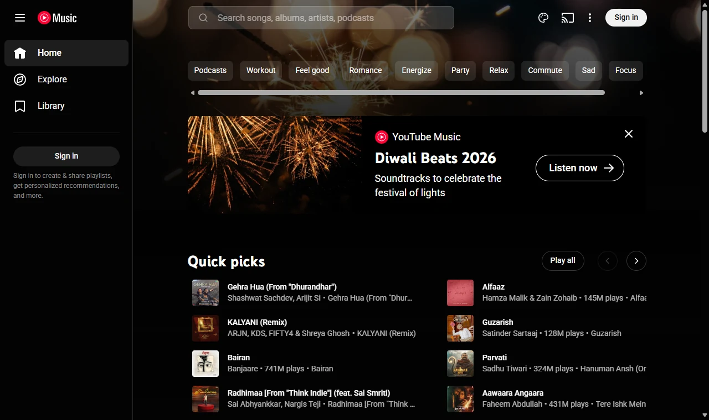
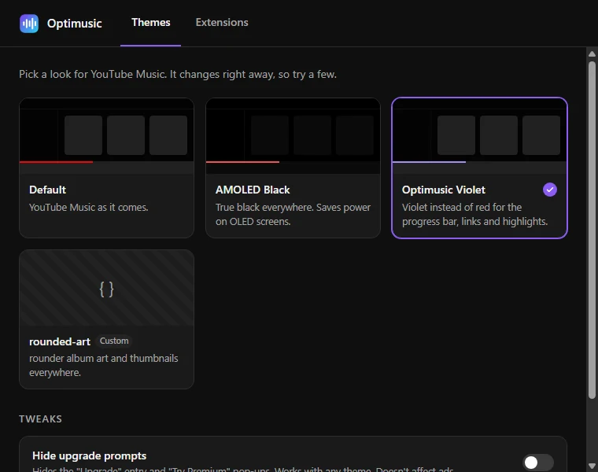
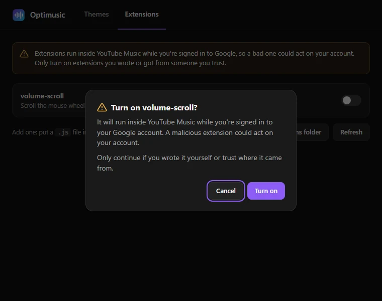

<p align="center"></p>

# Optimusic

**An unofficial, lightweight YouTube Music desktop app for Windows, macOS and Linux.**

**Website:** [imcymbiot.github.io/optimusic](https://imcymbiot.github.io/optimusic/)

Optimusic loads music.youtube.com in your system's own webview (WebView2 on Windows, WebKit on
macOS, WebKitGTK on Linux) instead of shipping a copy of Chromium like Electron apps do. It adds the desktop
features a browser tab is missing: media keys, a tray player, and background playback. It also
tunes the webview to use much less memory.

> Optimusic is an independent project, not affiliated with, endorsed by, or sponsored by Google
> or YouTube. YouTube Music is a trademark of Google LLC. You sign in to and use the real
> YouTube Music website, under its terms.

## Download

| Platform | Download |
|---|---|
| **Windows** 10 / 11 | [**Installer (.exe)**](https://github.com/ImCYMBIOT/optimusic/releases/latest/download/Optimusic-Windows-Setup.exe) · [MSI](https://github.com/ImCYMBIOT/optimusic/releases/latest/download/Optimusic-Windows.msi) |
| **Linux** | [**.deb** (Ubuntu / Debian)](https://github.com/ImCYMBIOT/optimusic/releases/latest/download/Optimusic-Linux.deb) · [**AppImage** (any distro)](https://github.com/ImCYMBIOT/optimusic/releases/latest/download/Optimusic-Linux.AppImage) |
| **macOS** 10.15+ *(untested)* | [**.dmg** (Apple silicon + Intel)](https://github.com/ImCYMBIOT/optimusic/releases/latest/download/Optimusic-macOS.dmg) |

These links always get the newest version. Older versions and release notes are on the
[Releases page](https://github.com/ImCYMBIOT/optimusic/releases). Install steps for each platform
are [below](#install-windows).

## Screenshots

<p align="center"></p>

<table>
  <tr>
    <td></td>
    <td></td>
  </tr>
  <tr>
    <td align="center">Pick a theme; it applies instantly</td>
    <td align="center">Extensions ask before they run</td>
  </tr>
</table>

## Why Optimusic
Memory on Windows, measured with `bench.ps1` (private working set of the whole process tree,
the same number Task Manager shows):

| | Idle | Playing | Hidden to tray, playing |
|---|---|---|---|
| **Optimusic v0.1.0** | **~250 MB** | **~200 MB** | **~150 MB** |
| Optimusic before memory tuning | 296 MB | 297 MB | 380 MB |
| [YTMDesktop](https://github.com/ytmdesktop/ytmdesktop) (Electron) | 343 MB | 413 MB | 343 MB |
| Firefox with a YouTube Music tab | 766 MB | 758 MB | 802 MB |

Hidden to the tray with nothing playing, Optimusic drops to about 45 MB.

Your numbers will vary with your PC, your library and what's on screen.

## Features
- **Media keys and OS media controls:** the Windows media overlay (SMTC), MPRIS on Linux
  (GNOME/KDE media widget), Now Playing on macOS
- **Tray player:** now playing, play/pause, next, previous, show/hide, quit
- **Discord Rich Presence:** "Listening to Optimusic (for YouTube Music)" with the song, artist, cover art, a
  progress bar, and "Listen on YouTube Music" and "Get Optimusic" buttons. Cleared when you pause, idle when Discord
  isn't running, and switchable from the tray ("Show on Discord")
- **Background playback:** closing the window hides it to the tray and the music keeps playing
- **Low-memory background mode:** while hidden or minimized, the webview stops rendering and trims its memory
- **Themes and extensions:** built-in themes (AMOLED Black, Optimusic Violet), your own CSS
  themes, and optional JavaScript extensions, in their own window (Ctrl+,). Think Spicetify for
  YouTube Music
- **Updates your way:** Off, Notify me (default) or Install automatically, from the tray's
  Updates menu. Every update is signed and checked before it's installed
- **Single instance:** launching it again just brings the window back
- Remembers window size and position
- External links open in your normal browser; Google sign-in stays in the app
- **Locked down:** the YouTube Music page can only report what's playing and open the settings
  window; it can't change settings, turn on extensions or touch anything else

## Install (Windows)
- [**Optimusic-Windows-Setup.exe**](https://github.com/ImCYMBIOT/optimusic/releases/latest/download/Optimusic-Windows-Setup.exe): installs just for you, no admin needed (recommended)
- [**Optimusic-Windows.msi**](https://github.com/ImCYMBIOT/optimusic/releases/latest/download/Optimusic-Windows.msi): standard MSI installer

WebView2 is built into Windows 10 and 11; the installer downloads it if it's missing. The
installers aren't code-signed yet, so SmartScreen may warn the first time (More info → Run anyway).

## Install (Linux)
- **Ubuntu / Debian:** download [**Optimusic-Linux.deb**](https://github.com/ImCYMBIOT/optimusic/releases/latest/download/Optimusic-Linux.deb), then
  `sudo apt install ./Optimusic-Linux.deb` (pulls in the GStreamer codecs it needs)
- **Any distro:** download [**Optimusic-Linux.AppImage**](https://github.com/ImCYMBIOT/optimusic/releases/latest/download/Optimusic-Linux.AppImage), make it
  executable (`chmod +x Optimusic-Linux.AppImage`) and run it. It includes its own audio codecs.

## Install (macOS) — untested, help wanted

> **Heads up:** I don't have a Mac yet, so the macOS version is built automatically but has
> **not been tested on a real Mac**. It should work (the code is the same as on Windows and
> Linux), and I'll test it as soon as I can. If you try it, please
> [open an issue](https://github.com/ImCYMBIOT/optimusic/issues) saying whether it worked, even
> if it did. That helps a lot.

1. Download [**Optimusic-macOS.dmg**](https://github.com/ImCYMBIOT/optimusic/releases/latest/download/Optimusic-macOS.dmg). It runs on both Apple silicon
   (M1 and later) and Intel Macs, macOS 10.15 or newer.
2. Open the `.dmg` and drag **Optimusic** into **Applications**.
3. Open Optimusic from Applications. The first time, macOS will block it, because the app isn't
   signed with a paid Apple developer account yet. To allow it:
   - Click **Done** (or **OK**) on the warning.
   - Open **System Settings → Privacy & Security**, scroll down to the message about Optimusic,
     and click **Open Anyway**. Enter your password if asked.
   - Open Optimusic again and click **Open**. You only have to do this once.

   If macOS says the app **"is damaged and can't be opened"**, it isn't; that's how macOS labels
   unsigned downloads. Open **Terminal** and run:
   ```bash
   xattr -dr com.apple.quarantine /Applications/Optimusic.app
   ```
   then open it again.

On macOS Optimusic lives in the menu bar (top right) instead of a tray, and clicking the Dock
icon brings the window back after you close it.

## Themes and extensions
Optimusic can restyle YouTube Music and run small add-on scripts, a bit like Spicetify does for
Spotify. Open **Themes & extensions** from the palette button in YouTube Music's top bar, with
**Ctrl+,** (**Cmd+,** on macOS), or from the tray. Changes apply instantly, and the window stays
open so you can try a few.

- **Themes:** pick **Default**, **AMOLED Black** (true black) or **Optimusic Violet** (violet
  instead of red accents), or any theme you've added. **Hide upgrade prompts** is a separate
  switch that works with any theme; it hides the "Upgrade" entry and "Try Premium" pop-ups (it
  doesn't touch ads).
- **Extensions:** each one has its own switch and starts **off**. Turning one on asks you to
  confirm first.

Both only ever run on music.youtube.com, never on Google's sign-in pages. The YouTube Music page
itself can only *open* this window; it can't change your settings or turn on extensions.

### Adding your own
Click **Open themes folder** / **Open extensions folder** in the window and drop a file in; it
shows up as soon as you switch back to the window (or click **Refresh**). The first comment in
the file becomes its description.
- **Themes** are `.css` files. YouTube Music's colors are CSS variables, so most themes just
  override them, for example:
  ```css
  html {
    --ytmusic-background: #101418 !important;
    --ytmusic-general-background-c: #101418 !important;
    --ytmusic-brand-link-text: #4fd1c5 !important;
  }
  ```
  Other useful ones: `--ytmusic-nav-bar`, `--ytmusic-player-bar-background`,
  `--ytmusic-general-background-a`, and `--paper-slider-active-color` on
  `ytmusic-player-bar tp-yt-paper-slider` for the progress bar.
- **Extensions** are `.js` files that run in the YouTube Music page after it loads. The player is
  `document.getElementById("movie_player")` (`playVideo()`, `getVolume()`, `setVolume()`…).
  Turning an extension off takes effect once YouTube Music reloads; the window offers a
  **Reload now** button.

The [`examples/`](examples) folder has a sample of each: `rounded-art.css` and `volume-scroll.js`
(scroll the mouse wheel over the player bar to change the volume).

The folders are in Optimusic's settings folder:
- Windows: `%APPDATA%\io.github.imcymbiot.optimusic\`
- macOS: `~/Library/Application Support/io.github.imcymbiot.optimusic/`
- Linux: `~/.config/io.github.imcymbiot.optimusic/`

> **Only install extensions you trust.** An extension runs inside YouTube Music while you're
> signed in to Google, so a malicious one could act on your account. Read the code first, or
> only use ones you wrote yourself. Themes are plain CSS and can't do that.

YouTube changes its website from time to time, which can break a theme or extension until it's
updated.

## Updates
Pick how Optimusic updates from the tray (menu bar on macOS) → **Updates**:

| Setting | What happens |
|---|---|
| **Off** | Optimusic never checks for updates and makes no update requests at all. |
| **Notify me** (default) | It checks GitHub at start-up and every 6 hours. When there's a new version, an **Update to vX** item appears at the top of the tray menu. Nothing downloads until you click it. |
| **Install automatically** | Same checks, but a new version is installed the next time you start Optimusic, before any music plays, so a song is never cut off. |

**Check now** is in the same menu. Every update is signed with the project's key, and Optimusic
refuses any update that isn't. On Linux, `.deb` updates ask for your password, like any package
install.

Coming from v0.2.x or earlier? Those versions can't update themselves, so install v0.3.0 or newer
by hand once; it updates itself from then on.

## Build from source

### Windows
Needs [Rust](https://rustup.rs) and the Tauri CLI (`cargo install tauri-cli --version "^2"`).

```powershell
cd src-tauri
cargo run                 # dev
cargo tauri build         # .msi + setup .exe in target/release/bundle/
```

### Ubuntu

```bash
# Tauri build deps
sudo apt install libwebkit2gtk-4.1-dev libsoup-3.0-dev libayatana-appindicator3-dev \
  librsvg2-dev libdbus-1-dev build-essential pkg-config

# Codecs WebKitGTK needs for YouTube audio (important — without these playback fails)
sudo apt install gstreamer1.0-plugins-good gstreamer1.0-plugins-bad gstreamer1.0-libav

# Rust, if you don't have it
curl --proto '=https' --tlsv1.2 -sSf https://sh.rustup.rs | sh

# Tauri CLI (for bundling)
cargo install tauri-cli --version "^2"
```

```bash
cd src-tauri
cargo run                 # dev
cargo tauri build         # .deb + AppImage in target/release/bundle/
```

## How the memory savings work (Windows)
Almost all of the memory is WebView2, not the Rust app (which uses about 5 MB). Optimusic tunes
it in two ways (see `BROWSER_ARGS` in `main.rs`):
- **Lean WebView2 flags:** Chromium's low-end-device mode; the GPU, network and audio services
  run inside the browser process; Edge services (translate, SmartScreen, sync, component
  updates…) are off. That's 9 processes down to 5.
- **Background mode:** when hidden to the tray or minimized, the webview is marked invisible and
  WebView2's Low memory target is set, so it trims down while the music keeps playing.

To experiment, `OPTIMUSIC_BROWSER_ARGS` replaces the whole flag string. For example, adding
`--disable-gpu --disable-gpu-compositing` saves about 20 MB more while the window is open, but uses more CPU.

Benchmark any app's whole process tree (results go to `bench-results.csv`):

```powershell
powershell -ExecutionPolicy Bypass -File .\bench.ps1 -App tauri -Phase playing -Seconds 120
```

## Troubleshooting
- **Blank window or rendering glitches on Windows:** the flags are the first suspect; run with
  `OPTIMUSIC_BROWSER_ARGS="--disable-features=msWebOOUI,msPdfOOUI,msSmartScreenProtection"` (the Tauri defaults).
- **Blank / white window on Linux (often NVIDIA):** `WEBKIT_DISABLE_DMABUF_RENDERER=1 optimusic`
- **Google says "this browser may not be secure" at sign-in:** try a different user agent, e.g.
  `OPTIMUSIC_USER_AGENT="Mozilla/5.0 (X11; Linux x86_64) AppleWebKit/605.1.15 (KHTML, like Gecko) Version/17.0 Safari/605.1.15" optimusic`
- **Nothing shows on Discord:** turn on Discord's User Settings → Activity Privacy → "Share
  your activity status", check "Show on Discord" in the tray menu, and make sure music is playing
  (presence is cleared while paused).
- **Tray icon missing on GNOME:** enable the "AppIndicator and KStatusNotifierItem Support" extension.

## Project layout
```
src-tauri/
  src/main.rs          window, tray, media controls, navigation policy, WebView2 tuning
  src/discord.rs       Discord Rich Presence, on its own thread
  src/updates.rs       update checks and the tray's Updates menu
  src/customize.rs     themes and extensions, and the commands behind their window
  themes/              the built-in themes
  src/bridge.js        injected into the page: player control + now-playing reports
  capabilities/        IPC allow-lists: music.youtube.com vs. the app's own settings page
  tauri.conf.json
dist/settings.html     the Themes & extensions window
examples/              a sample theme and extension
site/                  the website (GitHub Pages), plain HTML and CSS
.github/workflows/     release builds for Windows, Linux and macOS
bench.ps1              Windows CPU/memory benchmark for a whole process tree
```

## Roadmap
- Global hotkeys for desktops without MPRIS
- Mini-player window, desktop notifications on track change
- Last.fm scrobbling

## Forking
You're welcome to fork Optimusic. Building and running your fork works out of the box. To ship
**updates** to your own users you'll need your own signing key, because updates are only
accepted when they're signed with the key that matches the public key built into the app:
1. `cargo tauri signer generate -w ~/.tauri/yourapp.key`
2. Put the new public key in `plugins.updater.pubkey` in `src-tauri/tauri.conf.json`, and point
   `plugins.updater.endpoints` at your own repo's `releases/latest/download/latest.json`.
3. Create a `release` environment in your repo and add `TAURI_SIGNING_PRIVATE_KEY` and
   `TAURI_SIGNING_PRIVATE_KEY_PASSWORD` to it.

Also change the app's name, icon and `identifier`, and the Discord client ID in `discord.rs`, so
your fork isn't confused with Optimusic.

## Contributing
Pull requests are welcome. Because every merged change ends up signed and installed on users'
machines, each one is reviewed carefully, with extra scrutiny for changes to `.github/workflows/`,
`build.rs`, dependencies (`Cargo.toml` / `Cargo.lock`), `bridge.js` and `capabilities/`. Small,
focused PRs with a clear description get merged fastest.

Found a security problem? Please report it privately; see [SECURITY.md](SECURITY.md).

## License
MIT, see [LICENSE](LICENSE).
